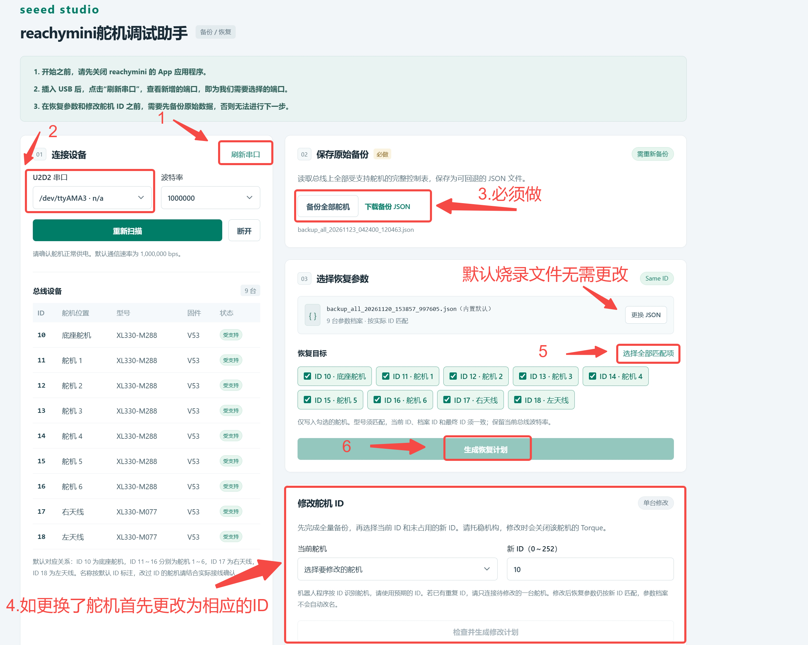

# Reachy Mini / Microduck 舵机调试助手

使用 Microduck 请先阅读 [Microduck 完整使用指南](README_MICRODUCK.md)，包含首次安装、SSH 网页连接、扫描备份、参数恢复、修改 ID 和退出恢复服务。下面的串口与服务示例针对 Reachy Mini。

## 安装与启动

### 有线版reachymini:

先安装 Python 3.10 或更新的版本。

#### Windows PowerShell：

```powershell
git clone https://github.com/xiehuangbao888/Reachymini_Servo_Assistant.git
cd Reachymini_Servo_Assistant
python -m pip install -r requirements.txt
python web_tool.py --port 8767
```

#### macOS Terminal（推荐使用虚拟环境，避免系统 Python 的安装限制）：

```bash
git clone https://github.com/xiehuangbao888/Reachymini_Servo_Assistant.git
cd Reachymini_Servo_Assistant
python3 -m venv .venv
source .venv/bin/activate
python -m pip install -r requirements.txt
python web_tool.py --port 8767
```

启动后自动打开浏览器，输入地址为 [http://127.0.0.1:8767](http://127.0.0.1:8767)。

### 无线版reachymini：

#### 1．电脑和机器人连接同一个 Wi-Fi，在 Windows PowerShell 执行：

```powershell
ssh -L 8767:127.0.0.1:8767 pollen@reachymini的ip地址
```

输入密码`root`

#### 2. 登录reachymini的树莓派后，首次安装项目：

```bash
git clone https://github.com/xiehuangbao888/Reachymini_Servo_Assistant.git
cd Reachymini_Servo_Assistant

python3 -m venv .venv
.venv/bin/python -m pip install -r requirements.txt
```

#### 3．停止占用舵机串口的服务，再启动工具，否则无法扫描到舵机：

先托稳机器人头部，退出其他舵机调试程序，然后执行：

```bash
sudo systemctl stop reachy-mini-daemon.service

.venv/bin/python web_tool.py --no-browser --port 8767
```

#### 4. 在 Windows 上另开一个 PowerShell 窗口，执行，输入密码后终端会没有输出是正常的

```powershell
ssh -N -o ExitOnForwardFailure=yes -L 127.0.0.1:8767:127.0.0.1:8767 pollen@reachy的ip
```

**在 Windows 浏览器打开：**

**[http://localhost:8767](http://localhost:8767)**

[http://127.0.0.1:8767](http://127.0.0.1:8767)

#### 4.结束后终端输入

```bash
sudo systemctl start reachy-mini-daemon.service
```

* 串口选择 **`/dev/ttyAMA3`**。
* 波特率选择 **`1,000,000`**


